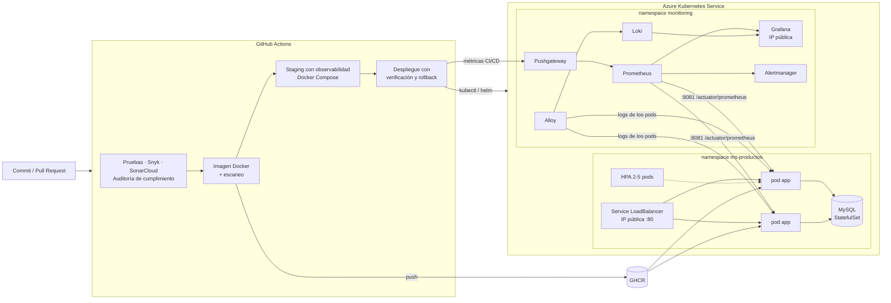
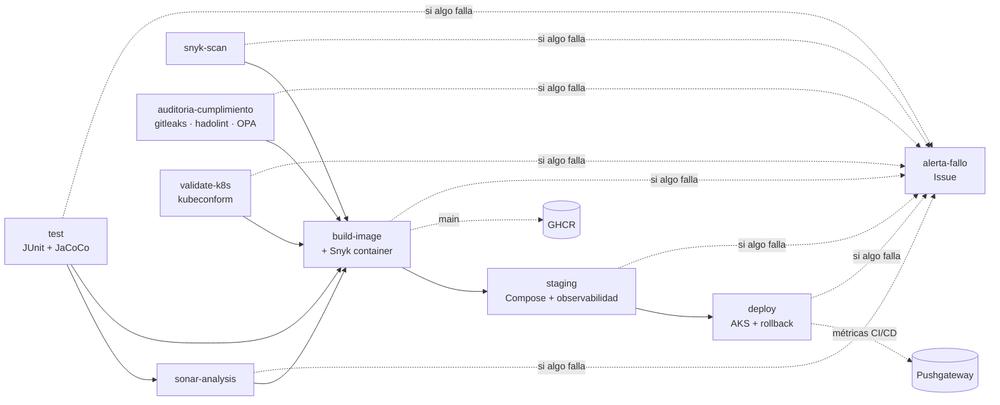

# ms-productos · Observabilidad y entornos reales en DevOps

[](https://github.com/benjaminstagnaro/ms-productos/actions/workflows/ci-cd.yml)

**Evaluación Parcial N°3 – Encargo: "Observabilidad y entornos reales en DevOps"**
DOY0101 · Ingeniería DevOps

**Autor:** Benjamín Stagnaro

Este repositorio continúa el pipeline de la EP2 (documentado en [`docs/EP2-pipeline-ci-cd.md`](docs/EP2-pipeline-ci-cd.md))
y lo extiende con **monitoreo, logging, métricas, dashboards, despliegue en Kubernetes en la nube y
auditoría automatizada de cumplimiento**.

---

## Tabla de contenidos

1. [Resumen](#1-resumen)
2. [Arquitectura](#2-arquitectura)
3. [Cumplimiento de la pauta](#3-cumplimiento-de-la-pauta)
4. [Estructura del repositorio](#4-estructura-del-repositorio)
5. [Pipeline CI/CD](#5-pipeline-cicd)
6. [IE1 · Monitoreo y logging](#6-ie1--monitoreo-y-logging)
7. [IE2 · Kubernetes en la nube (Azure AKS)](#7-ie2--kubernetes-en-la-nube-azure-aks)
8. [IE3 · Dashboard de métricas clave](#8-ie3--dashboard-de-métricas-clave)
9. [IE5 · Políticas de cumplimiento y auditoría](#9-ie5--políticas-de-cumplimiento-y-auditoría)
10. [IE4 · Integración en el pipeline y toma de decisiones](#10-ie4--integración-en-el-pipeline-y-toma-de-decisiones)
11. [IE6 · El pipeline se detiene ante fallas críticas](#11-ie6--el-pipeline-se-detiene-ante-fallas-críticas)
12. [Ejecución local](#12-ejecución-local)
13. [Configuración inicial](#13-configuración-inicial)
14. [Limitaciones y mejoras futuras](#14-limitaciones-y-mejoras-futuras)
15. [Evidencias](#15-evidencias)
16. [Conclusiones](#16-conclusiones)
17. [Referencias](#17-referencias)

---

## 1. Resumen

`ms-productos` es un microservicio REST (Spring Boot 4.1 · Java 17 · MySQL 8.4) que administra un catálogo de productos.
En la EP2 se automatizó su ciclo de vida (pruebas, Snyk, SonarCloud, Docker, despliegue simulado). En esta entrega se agregó:

| Necesidad | Solución |
|---|---|
| Saber si el servicio está sano, lento o fallando | Métricas Prometheus del microservicio (HTTP, JVM, CPU, BD y negocio) + reglas de alerta |
| Investigar un error | Logs JSON centralizados en **Loki**, con `request_id` para seguir cada petición |
| Ver todo en un solo lugar | Dashboard de **Grafana** versionado en Git con métricas de CI/CD y de ejecución |
| Un entorno real | Despliegue en **Azure Kubernetes Service (AKS)** con la plataforma de observabilidad instalada por el pipeline |
| Cumplir normas de seguridad | Auditoría automática: secretos (gitleaks), Dockerfile (hadolint + OPA), Kubernetes (OPA/Rego), configuración del repositorio y protección de rama |
| Proteger producción | Compuertas que detienen el pipeline y **rollback automático** si la versión nueva no queda sana |

## 2. Arquitectura



- La API se publica por el **puerto 8080**; Actuator (salud y métricas) escucha en el **puerto interno 8081**, que no se expone
  a Internet y que la `NetworkPolicy` solo permite desde el namespace `monitoring`.
- El mismo stack de observabilidad corre también con Docker Compose (`docker-compose.observabilidad.yml`) para desarrollo
  local y para el entorno de **staging** del pipeline. Ambos usan **los mismos archivos** de reglas y dashboard.

## 3. Cumplimiento de la pauta

| Requisito | Implementación | Dónde |
|---|---|---|
| **IE1** Monitoreo de logs, métricas de uso, errores y disponibilidad | Micrometer + Prometheus, logs JSON (ECS) en Loki vía Alloy, métrica de errores por tipo, `up` y sondas de salud, 10 reglas de alerta | [Sección 6](#6-ie1--monitoreo-y-logging) |
| **IE2** Microservicios orquestados en Kubernetes en la nube | AKS (Azure) creado con [`infra/azure/crear-cluster.sh`](infra/azure/crear-cluster.sh); el pipeline instala la plataforma de observabilidad con Helm y despliega con Kustomize | [Sección 7](#7-ie2--kubernetes-en-la-nube-azure-aks) |
| **IE3** Dashboard: tiempo de despliegue, cobertura, CPU/memoria, errores | Dashboard "ms-productos · DevOps" (dashboard como código) alimentado por Prometheus, Loki y el Pushgateway | [Sección 8](#8-ie3--dashboard-de-métricas-clave) |
| **IE5** Políticas de cumplimiento (SonarQube, branch protection, auditoría) | SonarCloud (EP2) + ruleset de protección de `main` + job `auditoria-cumplimiento` con 31 controles mapeados a ISO 27001, CIS, OWASP y NIST SSDF | [Sección 9](#9-ie5--políticas-de-cumplimiento-y-auditoría) |
| **IE4** Documentar la integración y la toma de decisiones | Este README: integración de cada herramienta y tabla "señal → decisión" | [Sección 10](#10-ie4--integración-en-el-pipeline-y-toma-de-decisiones) |
| **IE6** El pipeline se detiene ante una falla crítica | 5 escenarios de falla simulada que se ejecutan desde *Actions → Run workflow* | [Sección 11](#11-ie6--el-pipeline-se-detiene-ante-fallas-críticas) |

## 4. Estructura del repositorio

```text
.
├── .github/
│   ├── workflows/ci-cd.yml         # Pipeline CI/CD completo
│   ├── rulesets/proteccion-main.json  # Protección de la rama main (importable en GitHub)
│   ├── CODEOWNERS · dependabot.yml
├── src/main/java/cl/duoc/productos/
│   ├── observabilidad/             # MetricasNegocio, ObservabilidadConfig, RequestIdFilter   (EP3)
│   ├── exception/                  # Manejo de errores: responde, registra en log y cuenta en métricas
│   └── controller · service · repository · dto · model
├── observabilidad/                 # (EP3) una sola fuente de verdad para Compose y Kubernetes
│   ├── prometheus/                 #   scrape config + reglas de alerta y de registro
│   ├── grafana/                    #   datasources + dashboard "ms-productos · DevOps" (JSON)
│   ├── loki/ · alloy/              #   almacenamiento y recolección de logs
│   └── k8s/                        #   valores Helm: kube-prometheus-stack, Loki, Alloy, Pushgateway
├── k8s/
│   ├── base/                       # Deployment, StatefulSet MySQL, Service, HPA, PDB, NetworkPolicy
│   ├── components/observabilidad/  # PodMonitor (Prometheus descubre las réplicas)
│   └── overlays/{local,nube}/      # local = NodePort + Secret de ejemplo · nube = AKS (LoadBalancer)
├── politicas/                      # (EP3) políticas OPA/Rego + sus pruebas unitarias
│   ├── kubernetes/                 #   14 reglas (Pod Security Standards / CIS Kubernetes)
│   └── dockerfile/                 #   5 reglas (CIS Docker Benchmark)
├── scripts/
│   ├── cumplimiento/auditoria.py   # Auditoría completa + reporte mapeado a normas
│   ├── k8s/                        # renderizar, instalar-plataforma, desplegar (con rollback)
│   ├── observabilidad/             # publicar métricas CI/CD, verificar, generar tráfico, capturar dashboard
│   └── smoke-test.sh
├── infra/azure/crear-cluster.sh    # Crea el clúster AKS (Azure Cloud Shell)
├── docker-compose.yml              # App: nginx + réplicas + MySQL
├── docker-compose.observabilidad.yml  # Prometheus, Grafana, Loki, Alloy, Pushgateway
├── Dockerfile · SECURITY.md
└── docs/EP2-pipeline-ci-cd.md      # Documentación y evidencias de la EP2
```

## 5. Pipeline CI/CD

Archivo: [`.github/workflows/ci-cd.yml`](.github/workflows/ci-cd.yml)



| # | Job | Qué hace | Bloquea si… |
|---|---|---|---|
| 1 | `test` | 50+ pruebas (JUnit 5, Mockito, MockMvc) y cobertura JaCoCo ≥ 80 % | falla una prueba o baja la cobertura |
| 2 | `snyk-scan` | Vulnerabilidades en dependencias (SCA); cuenta hallazgos por severidad para el dashboard | hay vulnerabilidades altas o críticas |
| 3 | `sonar-analysis` | Análisis estático con Quality Gate | no se cumple el Quality Gate |
| 4 | `auditoria-cumplimiento` | **(EP3)** 31 controles: secretos, Dockerfile, políticas Kubernetes, configuración del repo y de la rama | falla un control CRÍTICO o ALTO |
| 5 | `validate-k8s` | Valida contra el esquema de Kubernetes los manifiestos reales de producción, el overlay local y los recursos de observabilidad (CRDs) | un manifiesto es inválido |
| 6 | `build-image` | Imagen multi-stage, escaneo Snyk Container y publicación en GHCR (`versión-commit`) | la imagen tiene vulnerabilidades críticas |
| 7 | `staging` | **(EP3)** Levanta app + Prometheus/Grafana/Loki/Alloy con Compose, smoke tests, escalado a 3 réplicas, tráfico, verificación de observabilidad y captura del dashboard | falla un smoke test o la observabilidad no funciona |
| 8 | `deploy` | **(EP3)** Instala la plataforma de observabilidad en AKS (Helm), despliega, verifica con Prometheus y publica las métricas del pipeline | la versión nueva no queda sana → **rollback** |
| 9 | `dependency-review` | En PRs revisa las dependencias nuevas | dependencia nueva con vulnerabilidad alta |
| 10 | `alerta-fallo` | Abre un Issue con las etapas fallidas | — |

**Artefactos por ejecución:** `jacoco-report`, `surefire-reports`, `snyk-report`, `snyk-container-report`, `reporte-cumplimiento`,
`docker-image`, `deploy-logs`, `dashboard-staging` y `evidencia-produccion` (estado del clúster + captura del dashboard).

## 6. IE1 · Monitoreo y logging

### 6.1 Métricas

El microservicio expone `/actuator/prometheus` en el puerto de gestión **8081**. Todas las métricas llevan las etiquetas
`application`, `version` y `commit`, así se sabe qué versión generó cada dato.

| Aspecto | Métrica | Origen |
|---|---|---|
| Uso / tráfico | `http_server_requests_seconds_count` por URI, método y código | Spring Boot |
| Latencia | `http_server_requests_seconds_bucket` (histograma, SLO 100 ms / 300 ms / 1 s) | Spring Boot + [`ObservabilidadConfig`](src/main/java/cl/duoc/productos/observabilidad/ObservabilidadConfig.java) |
| Errores | `productos_errores_total{tipo, status}` (validación, no encontrado, stock insuficiente, interno…) | [`GlobalExceptionHandler`](src/main/java/cl/duoc/productos/exception/GlobalExceptionHandler.java) |
| Disponibilidad | `up{job="ms-productos"}` por réplica + sondas `/livez` `/readyz` | Prometheus + Actuator |
| CPU / memoria | `process_cpu_usage`, `jvm_memory_used_bytes`; en Kubernetes `container_cpu_usage_seconds_total` y `container_memory_working_set_bytes` | Micrometer + kubelet |
| Base de datos | `hikaricp_connections_active/pending` | Spring Boot |
| Negocio | `productos_creados_total`, `productos_eliminados_total`, `productos_stock_movimientos_total{tipo}`, `productos_stock_rechazos_total` | [`MetricasNegocio`](src/main/java/cl/duoc/productos/observabilidad/MetricasNegocio.java) |

### 6.2 Logs

- La aplicación escribe **logs JSON (formato Elastic Common Schema)**: nivel, logger, servicio, versión, entorno y mensaje como campos.
- [`RequestIdFilter`](src/main/java/cl/duoc/productos/observabilidad/RequestIdFilter.java) asigna un **`request_id`** a cada petición
  (o reutiliza el que envía nginx), lo agrega a todos los logs de esa petición y lo devuelve en el encabezado `X-Request-Id`.
  Cada petición a la API deja una línea de acceso: `GET /api/productos/7 -> 404 (3 ms)`.
- nginx también escribe su log de acceso en JSON con el mismo `request_id`.
- **Grafana Alloy** recolecta los logs (de los contenedores en Compose; de los pods en Kubernetes) y los envía a **Loki** con las
  etiquetas `app`, `pod`, `namespace` y `level`. Ejemplos de consultas en Grafana → Explore:

```logql
{app="ms-productos", level="ERROR"}                         # errores de todas las réplicas
{app="ms-productos"} | json | request_id="<id>"             # todo lo que pasó en una petición
sum by (level) (count_over_time({app="ms-productos"}[5m]))  # volumen de logs por nivel
```

### 6.3 Alertas (detección de anomalías)

Definidas en [`observabilidad/prometheus/reglas/ms-productos.yml`](observabilidad/prometheus/reglas/ms-productos.yml) y cargadas
en Prometheus (Compose) o como `PrometheusRule` (Kubernetes):

| Alerta | Condición | Severidad |
|---|---|---|
| `MsProductosSinReplicas` | ninguna réplica responde durante 2 min | crítica |
| `MsProductosReplicaCaida` | una réplica no responde durante 1 min | advertencia |
| `MsProductosTasaErrores5xxAlta` | más del 5 % de peticiones con error 5xx (5 min) | crítica |
| `MsProductosLatenciaAlta` | p95 sobre 500 ms (5 min) | advertencia |
| `MsProductosMemoriaHeapAlta` | heap sobre 90 % (5 min) | advertencia |
| `MsProductosCpuAlta` | CPU sobre 85 % (10 min) | advertencia |
| `MsProductosPoolConexionesAgotado` | peticiones esperando conexión a MySQL | advertencia |
| `MsProductosRechazosDeStockInusuales` | más de 5 rechazos de stock por minuto | info |
| `CicdCoberturaBajoElMinimo` / `CicdDespliegueLento` | cobertura < 80 % · despliegue > 10 min | advertencia / info |

Además, kube-prometheus-stack agrega las alertas estándar del clúster (nodos, pods en *CrashLoop*, disco, etc.).

### 6.4 Seguridad de la observabilidad

- Actuator **no se publica**: el puerto 8081 no está en el Service público ni pasa por nginx (`/actuator/*` responde 404 desde afuera;
  los smoke tests lo comprueban).
- Prometheus, Loki y Grafana en Compose solo escuchan en `127.0.0.1`. En AKS, la contraseña de Grafana se genera al azar y queda
  como Secret del clúster; los visitantes anónimos solo pueden **ver** dashboards.

## 7. IE2 · Kubernetes en la nube (Azure AKS)

### 7.1 El clúster

[`infra/azure/crear-cluster.sh`](infra/azure/crear-cluster.sh) (se ejecuta una vez en Azure Cloud Shell) crea:

- Grupo de recursos `rg-ms-productos` y clúster **AKS `aks-ms-productos`** (tier Free: el plano de control no se cobra).
- 1 nodo `Standard_B2ms` (2 vCPU / 8 GB), red **Azure CNI + Cilium**, que hace cumplir las `NetworkPolicy` del proyecto.
- Una credencial para GitHub Actions que se guarda como secreto `KUBECONFIG_AKS` del environment `produccion`.

### 7.2 Qué hace el pipeline en cada despliegue (job `deploy`)

1. **Instala o actualiza la plataforma de observabilidad** con Helm y versiones fijas
   ([`scripts/k8s/instalar-plataforma.sh`](scripts/k8s/instalar-plataforma.sh)):

   | Release | Chart | Para qué |
   |---|---|---|
   | `kube-prometheus-stack` | prometheus-community 93.10.0 | Prometheus Operator, Prometheus, Alertmanager, Grafana, node-exporter, kube-state-metrics |
   | `loki` | grafana-community 21.6.0 | Logs (modo monolítico, 7 días de retención) |
   | `alloy` | grafana 1.16.0 | Recolector de logs de los pods |
   | `pushgateway` | prometheus-community 3.11.2 | Recibe las métricas del pipeline |

2. **Despliega** ([`scripts/k8s/desplegar.sh`](scripts/k8s/desplegar.sh)) el overlay [`k8s/overlays/nube`](k8s/overlays/nube) con la
   imagen exacta que se probó (`ghcr.io/…/ms-productos:<versión>-<commit>`), junto con la integración de observabilidad:
   `PodMonitor`, `PrometheusRule` y el dashboard como `ConfigMap` (Grafana lo carga solo).
3. **Espera el rolling update** (`maxUnavailable: 0`: la versión anterior sigue atendiendo hasta que la nueva está lista).
4. **Pruebas de humo** a través del Service y luego por la **IP pública** del LoadBalancer.
5. **Verificación con Prometheus**: todas las réplicas deben aparecer como `up` y la tasa de errores 5xx debe ser ≤ 5 %.
6. Si los pasos 3, 4 o 5 fallan → **`kubectl rollout undo`** a la revisión anterior, con diagnóstico (eventos y logs) en el resumen.
7. Publica las métricas del pipeline en el Pushgateway, genera tráfico, comprueba métricas/logs/dashboard y captura el dashboard.

Cada revisión queda anotada (`kubectl rollout history`) con la imagen, el commit y la ejecución del pipeline que la generó.

### 7.3 Configuración de los manifiestos

| Recurso | Configuración |
|---|---|
| `Deployment` | 2 réplicas, rolling update sin caída, sondas *startup/liveness/readiness* en el puerto de gestión, usuario no root, sistema de archivos de solo lectura, sin capacidades |
| `HorizontalPodAutoscaler` | 2 a 5 réplicas al 70 % de CPU |
| `PodDisruptionBudget` | siempre al menos 1 réplica durante mantenciones |
| `StatefulSet` MySQL | volumen persistente, usuario 999 (no root), excepción documentada a "solo lectura" |
| `NetworkPolicy` | MySQL solo desde la app; puerto 8081 de la app solo desde `monitoring` |
| `Service` | `LoadBalancer` (IP pública de Azure) solo para el puerto 80 → 8080 |
| `Secret` | lo crea el pipeline la primera vez con contraseñas aleatorias; nunca se versiona |

> Si el secreto `KUBECONFIG_AKS` todavía no existe, el job `deploy` usa un clúster efímero **kind** dentro del runner y ejecuta
> exactamente los mismos pasos. Así el pipeline nunca queda roto, pero el entorno productivo real es AKS.

## 8. IE3 · Dashboard de métricas clave

El dashboard **"ms-productos · DevOps"** ([`observabilidad/grafana/dashboards/ms-productos-devops.json`](observabilidad/grafana/dashboards/ms-productos-devops.json))
es código: se versiona en Git y se carga automáticamente en Grafana (Compose y Kubernetes). Tiene cinco secciones:

| Sección | Paneles | Fuente |
|---|---|---|
| **CI/CD · Calidad y despliegue** | **Tiempo del último despliegue** e historial, *lead time* commit → producción, **cobertura de pruebas** (líneas y ramas), pruebas ejecutadas/fallidas, Quality Gate, vulnerabilidades críticas/altas, controles de cumplimiento, despliegues en 7 días, versión en producción | Pipeline → Pushgateway → Prometheus |
| **Disponibilidad y tráfico** | disponibilidad actual y del período, réplicas activas, peticiones/s por código, latencia p50/p95/p99, % de errores 5xx | Prometheus |
| **Errores registrados y logs** | errores del período, errores 500, errores por tipo, **alertas activas**, logs WARN/ERROR y de acceso | Prometheus + Loki |
| **Recursos: CPU y memoria** | CPU y heap por réplica, pool de conexiones, CPU y memoria por pod (Kubernetes) | Prometheus (Micrometer + kubelet) |
| **Negocio** | productos creados/eliminados, rechazos de stock, movimientos de stock | Prometheus |

Las métricas del pipeline se calculan en cada job y el job de despliegue las publica con
[`publicar-metricas-cicd.sh`](scripts/observabilidad/publicar-metricas-cicd.sh):

| Métrica | Se calcula en |
|---|---|
| `cicd_despliegue_duracion_segundos` | `deploy`: desde que se aplican los manifiestos hasta que las réplicas nuevas están listas |
| `cicd_pipeline_duracion_segundos` | `deploy`: desde que empezó la ejecución hasta que la versión quedó funcionando (lead time) |
| `cicd_cobertura_lineas_ratio`, `cicd_cobertura_ramas_ratio` | `test` (reporte JaCoCo) |
| `cicd_pruebas_total`, `cicd_pruebas_fallidas` | `test` (reportes Surefire) |
| `cicd_vulnerabilidades{origen, severidad}` | `snyk-scan` y `build-image` (reportes JSON de Snyk) |
| `cicd_auditoria_controles{resultado}` | `auditoria-cumplimiento` |
| `cicd_quality_gate_aprobado` | `sonar-analysis` |
| `cicd_despliegue_info{version, commit, ejecucion}` | `deploy` |

Como Prometheus guarda cada valor en el tiempo, el dashboard muestra **la historia** de los despliegues, no solo el último.
Las versiones nuevas aparecen como anotaciones (líneas verticales) en los gráficos.

## 9. IE5 · Políticas de cumplimiento y auditoría

### 9.1 Herramientas y controles

| Capa | Herramienta | Qué exige |
|---|---|---|
| Código | **SonarCloud** (Quality Gate) | sin bugs ni vulnerabilidades nuevas, cobertura y duplicación dentro del umbral |
| Dependencias | **Snyk** + **Dependabot** + Dependency Review | sin vulnerabilidades altas/críticas; actualizaciones semanales |
| Secretos | **gitleaks** (archivos e historial) | ninguna credencial en el repositorio |
| Dockerfile | **hadolint** + políticas OPA propias | usuario no root, versiones fijas, HEALTHCHECK, COPY en vez de ADD, sin secretos en ENV/ARG |
| Kubernetes | **OPA / conftest** ([`politicas/kubernetes`](politicas/kubernetes/kubernetes.rego)) | sin privilegios ni root, capacidades eliminadas, límites de recursos, imagen con versión, sondas, solo lectura, sin `hostPath`, sin Secrets versionados, sin NodePort en producción |
| Repositorio | [`auditoria.py`](scripts/cumplimiento/auditoria.py) | permisos mínimos del token, acciones fijadas por SHA, `.env` fuera de Git, Dependabot, SECURITY.md, CODEOWNERS, cobertura mínima ≥ 80 %, compuertas de seguridad presentes en el pipeline, Actuator en puerto interno |
| Rama `main` | **Ruleset de GitHub** ([`proteccion-main.json`](.github/rulesets/proteccion-main.json)) | todo cambio entra por PR, con 7 checks obligatorios, historial lineal sin *force push* ni borrado; la auditoría verifica por API que siga activo |

Las políticas OPA tienen sus propias **pruebas unitarias** (`conftest verify`, 23 pruebas): si alguien modifica una regla y la deja
sin efecto, la auditoría lo detecta.

### 9.2 Reporte de auditoría

Cada ejecución genera el artefacto `reporte-cumplimiento` (JSON + Markdown) y lo muestra en el resumen de la ejecución.
Cada control indica su severidad y la norma con la que se relaciona:

| Norma | Controles relacionados |
|---|---|
| ISO/IEC 27001:2022 – Anexo A | A.5.17 información de autenticación · A.8.2 accesos privilegiados · A.8.4 acceso al código fuente · A.8.8 vulnerabilidades técnicas · A.8.9 gestión de la configuración · A.8.15/A.8.16 registro y monitoreo · A.8.25 desarrollo seguro · A.8.29 pruebas de seguridad · A.8.32 gestión de cambios |
| CIS Docker Benchmark §4 | 4.1 usuario del contenedor · 4.6 HEALTHCHECK · 4.9 COPY en vez de ADD · 4.10 secretos en Dockerfile |
| Kubernetes Pod Security Standards / CIS Kubernetes §5.2 | privilegios, root, capacidades, `host*`, sistema de archivos |
| OWASP Top 10 (2021) | A05 configuración insegura · A06 componentes vulnerables · A08 integridad del software · A09 fallas de registro y monitoreo |
| NIST SSDF (SP 800-218) | PO.3 cadena de herramientas · PS.1 proteger el código · PW.8 pruebas · RV.1 identificar vulnerabilidades |

**Severidad:** un control **CRÍTICO** o **ALTO** que falla detiene el pipeline; uno **MEDIO** queda como advertencia.
**Excepciones:** solo se aceptan documentadas en el propio manifiesto (ej. MySQL usa la anotación
`cumplimiento/excepcion-readonly` con el motivo) y quedan registradas como advertencia en cada reporte.

## 10. IE4 · Integración en el pipeline y toma de decisiones

### 10.1 Cómo se integra cada herramienta

| Etapa | Herramienta | Momento | Efecto en el pipeline |
|---|---|---|---|
| Antes de construir | JUnit/JaCoCo, Snyk, SonarCloud, gitleaks, hadolint, OPA, kubeconform | en paralelo en cada PR y push | si alguna falla, **no se construye la imagen** |
| Al construir | Snyk Container | sobre la imagen final | no se publica una imagen con vulnerabilidades críticas |
| Staging | Prometheus, Loki, Grafana, Alloy (Compose) | con la misma imagen | se comprueba que métricas, alertas, logs y dashboard funcionan **antes** de producción |
| Producción | Helm + Kustomize en AKS, Prometheus | después de staging | verificación de salud y **rollback automático** |
| Después | Pushgateway + Grafana, Alertmanager, Issue automático | continuamente | historial de calidad y despliegues; alertas ante anomalías |

### 10.2 Señales y decisiones técnicas

| Señal (dónde se ve) | Decisión |
|---|---|
| Sube la **latencia p95** o la **CPU** de las réplicas (dashboard, alerta `LatenciaAlta`/`CpuAlta`) | Revisar el endpoint lento en "peticiones por código"; ajustar `requests/limits` o el umbral del HPA |
| Aumentan los **errores 500** (panel "Errores internos", alerta `TasaErrores5xxAlta`) | Buscar en Loki `{level="ERROR"}`, seguir el `request_id` y, si coincide con un despliegue (anotación), volver a la versión anterior |
| Heap cerca del máximo (`MemoriaHeapAlta`) | Aumentar el límite de memoria o investigar una fuga antes de que el pod se reinicie |
| Conexiones en espera en el pool | Aumentar `DB_POOL_SIZE` o revisar consultas lentas |
| La **cobertura** baja en el historial | Exigir pruebas en el PR antes de que llegue al mínimo y bloquee |
| El **tiempo de despliegue** crece | Revisar el tamaño de la imagen y el tiempo de arranque (sondas) |
| Aparecen **vulnerabilidades** (Snyk, Dependabot) | Actualizar la dependencia (caso real abajo) o eliminarla si no se usa (caso CVE-2026-92877 de la EP2) |
| Un control de **cumplimiento** falla | Corregir antes de mezclar; si es inevitable, documentar la excepción en el manifiesto |

### 10.3 Caso real durante esta entrega

Al abrir el PR de la EP3, **Snyk detuvo el pipeline**: desde la EP2 se habían publicado 4 vulnerabilidades altas en
`spring-core`, `spring-beans`, `spring-web` (7.0.10) y `spring-boot-actuator` (4.1.2), más una crítica en `jackson-databind` 3.1.7.
La decisión fue actualizar **Spring Boot 4.1.2 → 4.1.3** (trae Spring Framework 7.0.11 y Jackson 3.1.8); el siguiente análisis
reportó **0 vulnerabilidades** y las pruebas siguieron en verde.

Después, **SonarCloud rechazó el Quality Gate** (Security Rating C en código nuevo) por el uso de `npx` en el pipeline
(`githubactions:S6505`: puede instalar paquetes y ejecutar sus scripts) y por URLs `http://` explícitas (`githubactions:S5332`).
Se reemplazó `npx` por el Chrome que ya trae el runner y las direcciones públicas pasaron a un script con la nota sobre TLS
(ver [sección 14](#14-limitaciones-y-mejoras-futuras)).

## 11. IE6 · El pipeline se detiene ante fallas críticas

En **Actions → CI/CD ms-productos → Run workflow** se elige una falla en `simular_falla`. La falla se inyecta **solo en la
ejecución** (no se sube al repositorio) y es detectada por la herramienta real correspondiente:

| Escenario | Qué se inyecta | Quién lo detecta | Resultado |
|---|---|---|---|
| `prueba-fallida` | Bug que permite dejar el stock en negativo | Pruebas unitarias | `test` falla → no hay imagen ni despliegue |
| `vulnerabilidad-dependencia` | `log4j-core 2.14.1` (Log4Shell, CVE-2021-44228) | Snyk | `snyk-scan` falla → no hay imagen ni despliegue |
| `secreto-expuesto` | Credenciales falsas de AWS y GitHub en un `.properties` (aleatorias) | gitleaks (control SEC-01) | `auditoria-cumplimiento` falla |
| `politica-kubernetes` | Contenedor privilegiado, como root y sin límites | OPA/conftest (K8S-01…05, K8S-08) | `auditoria-cumplimiento` falla |
| `despliegue-defectuoso` | Versión que no puede conectarse a la base de datos | Rolling update + sondas | `deploy` falla → **rollback automático**; producción sigue con la versión anterior |

En todos los casos el job `alerta-fallo` abre un **Issue** con las etapas fallidas, y los artefactos de la ejecución
(`reporte-cumplimiento`, `snyk-report`, `evidencia-produccion`) quedan como evidencia. Además, la **protección de rama** impide
mezclar a `main` un PR cuyos checks no pasan.

## 12. Ejecución local

Requisitos: Docker Desktop.

```bash
cp .env.example .env                                    # cambiar contraseñas
docker compose -f docker-compose.yml -f docker-compose.observabilidad.yml up -d --build --wait
bash scripts/smoke-test.sh http://localhost:8080 2
bash scripts/observabilidad/generar-trafico.sh http://localhost:8080 30
bash scripts/observabilidad/verificar-observabilidad.sh 2
```

| Servicio | URL |
|---|---|
| API | http://localhost:8080/api/productos |
| Grafana (dashboard por defecto) | http://localhost:3000 |
| Prometheus (alertas en `/alerts`) | http://localhost:9090 |

Kubernetes local (Docker Desktop, kind o minikube): `kubectl apply -k k8s/overlays/local` → http://localhost:30080/api/info

Pruebas y políticas: `./mvnw clean verify` · `conftest verify --policy politicas/kubernetes` · `conftest verify --policy politicas/dockerfile`

## 13. Configuración inicial

Además de lo configurado en la EP2 (secretos `SNYK_TOKEN` y `SONAR_TOKEN`, Dependabot):

1. **Protección de `main`:** *Settings → Rules → Rulesets → New ruleset → Import a ruleset* →
   [`.github/rulesets/proteccion-main.json`](.github/rulesets/proteccion-main.json).
2. **Dependency graph** activo (*Settings → Advanced Security*), necesario para el job `dependency-review`.
3. **Clúster AKS:** en [Azure Cloud Shell](https://shell.azure.com):
   ```bash
   git clone https://github.com/benjaminstagnaro/ms-productos && cd ms-productos
   bash infra/azure/crear-cluster.sh
   ```
   y guardar el texto que imprime como secreto **`KUBECONFIG_AKS`** del environment **`produccion`**
   (*Settings → Environments → produccion*), con *Deployment branches* limitado a `main`.
4. **Paquete de la imagen público** (*Packages → ms-productos → Package settings → Change visibility*), para que AKS
   descargue la imagen sin credenciales.

**Costos:** con Azure for Students el plano de control es gratis y el nodo cuesta ~US$2 al día. Cuando no se use:
`az aks stop -g rg-ms-productos -n aks-ms-productos` (y `az aks start …` para volver a encenderlo).

## 14. Limitaciones y mejoras futuras

- **Sin HTTPS:** la API y Grafana se publican por IP con HTTP porque el proyecto no tiene dominio. En un entorno real se usaría un
  Ingress (o Gateway API) con certificados automáticos (cert-manager + Let's Encrypt).
- **Credencial del clúster:** el pipeline usa un kubeconfig guardado como secreto del environment. Lo ideal es **OIDC** entre
  GitHub y Azure (identidad federada, sin secretos de larga duración), que requiere permisos en Microsoft Entra ID.
- **Un solo nodo:** suficiente para la evaluación; en producción se usarían al menos 2 nodos en distintas zonas y el autoescalado del clúster.
- **Alertmanager** está instalado pero sin canal de notificación (correo/Slack); las alertas se ven en Grafana y Prometheus.
- **Trazas distribuidas** (OpenTelemetry + Tempo) serían el siguiente paso cuando haya más de un microservicio.

## 15. Evidencias

Las evidencias de cada ejecución quedan en la pestaña **Actions** (resúmenes y artefactos). Las capturas de la EP2 están en
[`docs/EP2-pipeline-ci-cd.md`](docs/EP2-pipeline-ci-cd.md#15-evidencias).

## 16. Conclusiones

Con esta entrega entendí que automatizar el despliegue no es suficiente si después no sé qué está pasando con el servicio.
Agregar métricas, logs y un dashboard cambió la forma de revisar el proyecto: ahora puedo ver cuánto tarda un despliegue,
cuántos errores hubo, cuánta CPU y memoria usa cada réplica, y seguir una petición concreta en los logs con su `request_id`.

Lo que más me sirvió fue ver los controles funcionando de verdad: al abrir el PR, Snyk detuvo el pipeline por vulnerabilidades
nuevas en Spring que no existían cuando entregué la EP2, y SonarCloud rechazó el Quality Gate por un problema en el propio
pipeline. También aprendí que el cumplimiento normativo se puede convertir en reglas automáticas (políticas OPA, protección de
rama, auditoría con reporte) en lugar de una revisión manual, y que desplegar en un clúster real como AKS obliga a pensar en
cosas que en un entorno simulado no aparecen: costos, credenciales, IP públicas, permisos y cómo volver atrás si una versión falla.

## 17. Referencias

- Material DOY0101 (unidades 2 y 3) y encargo EP3 "Observabilidad y entornos reales en DevOps".
- [Spring Boot – Actuator y métricas](https://docs.spring.io/spring-boot/reference/actuator/metrics.html) · [Logging estructurado](https://docs.spring.io/spring-boot/reference/features/logging.html#features.logging.structured)
- [Prometheus](https://prometheus.io/docs/) · [Prometheus Operator](https://prometheus-operator.dev/) · [kube-prometheus-stack](https://github.com/prometheus-community/helm-charts/tree/main/charts/kube-prometheus-stack)
- [Grafana](https://grafana.com/docs/grafana/latest/) · [Loki](https://grafana.com/docs/loki/latest/) · [Alloy](https://grafana.com/docs/alloy/latest/)
- [Azure Kubernetes Service](https://learn.microsoft.com/azure/aks/) · [Kustomize](https://kubectl.docs.kubernetes.io/references/kustomize/) · [Helm](https://helm.sh/docs/)
- [Open Policy Agent / conftest](https://www.conftest.dev/) · [gitleaks](https://github.com/gitleaks/gitleaks) · [hadolint](https://github.com/hadolint/hadolint)
- [Kubernetes Pod Security Standards](https://kubernetes.io/docs/concepts/security/pod-security-standards/) · [CIS Benchmarks](https://www.cisecurity.org/cis-benchmarks)
- ISO/IEC 27001:2022 – Anexo A · [OWASP Top 10 (2021)](https://owasp.org/Top10/) · [NIST SP 800-218 (SSDF)](https://csrc.nist.gov/pubs/sp/800/218/final)
- [GitHub – Rulesets](https://docs.github.com/repositories/configuring-branches-and-merges-in-your-repository/managing-rulesets/about-rulesets)
