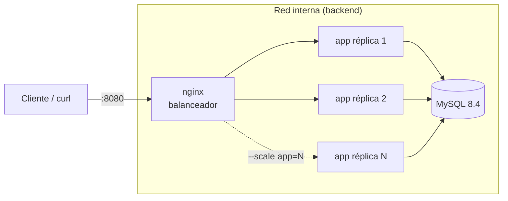
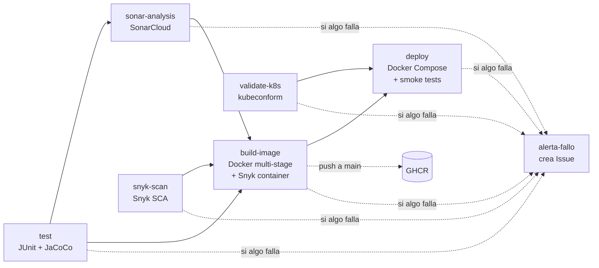

# ms-productos · Pipeline CI/CD con GitHub Actions

[](https://github.com/benjaminstagnaro/ms-productos/actions/workflows/ci-cd.yml)

**Evaluación Parcial N°2 – Encargo: "Añadiéndole complejidad a nuestro pipeline"**
DOY0101 · Ingeniería DevOps

**Autor:** Benjamín Stagnaro 
---
## Tabla de contenidos

1. [Descripción](#1-descripción)
2. [Arquitectura](#2-arquitectura)
3. [Estructura del repositorio](#3-estructura-del-repositorio)
4. [API del microservicio](#4-api-del-microservicio)
5. [Ejecución local](#5-ejecución-local)
6. [Pipeline CI/CD](#6-pipeline-cicd)
7. [Cumplimiento del encargo](#7-cumplimiento-del-encargo)
8. [Seguridad y gobernanza](#8-seguridad-y-gobernanza)
9. [Escalabilidad y orquestación](#9-escalabilidad-y-orquestación)
10. [Trazabilidad](#10-trazabilidad-del-desarrollo-a-producción)
11. [Calidad](#11-cómo-se-garantiza-la-calidad)
12. [Configuración inicial del repositorio](#12-configuración-inicial-del-repositorio)
13. [Despliegue en Kubernetes](#13-despliegue-en-kubernetes-opcional)
14. [Ajustes respecto al material del curso](#14-ajustes-respecto-al-material-del-curso)
15. [Evidencias](#15-evidencias)
16. [Uso de Inteligencia Artificial](#16-uso-de-inteligencia-artificial)
17. [Conclusiones y reflexión personal](#17-conclusiones-y-reflexión-personal)
18. [Referencias](#18-referencias)

---

## 1. Descripción

`ms-productos` es un microservicio REST desarrollado con **Spring Boot 4.1 y Java 17** que administra un catálogo de productos
(CRUD, filtro por categoría y control de stock con regla de negocio: el stock nunca puede quedar negativo).
Persiste en **MySQL 8.4** usando Spring Data JPA.

El objetivo del encargo es automatizar **todo su ciclo de vida** con un pipeline CI/CD en GitHub Actions que incluye:

- Contenerización con un **Dockerfile multi-stage** optimizado.
- **Pruebas unitarias** (JUnit 5 + Mockito + MockMvc) con **cobertura medida por JaCoCo** y un mínimo exigido.
- **Análisis de seguridad**: Dependabot, Snyk (dependencias e imagen Docker) y SonarCloud (código).
- **Bloqueos y alertas** cuando un análisis falla.
- **Despliegue automático** en un entorno simulado con **Docker Compose** y pruebas de humo.
- **Orquestación** con Docker Compose (réplicas + balanceador) y manifiestos de **Kubernetes** con autoescalado.

## 2. Arquitectura

### Arquitectura en ejecución (entorno simulado)



- **nginx** es el único servicio con puerto publicado en el host y reparte las peticiones entre las réplicas.
- **app** y **mysql** viven en una red `internal`: no son accesibles desde fuera.
- Cada servicio tiene **healthcheck** y **límites de CPU/memoria**; `depends_on: condition: service_healthy`
  asegura el orden de arranque real (MySQL listo → app sana → nginx).

## 3. Estructura del repositorio

```text
.
├── .github/
│   ├── dependabot.yml           # Actualizaciones automáticas (Maven, Docker, Compose, Actions)
│   └── workflows/ci-cd.yml      # Pipeline CI/CD completo
├── .mvn/wrapper/ + mvnw         # Maven Wrapper (versión de Maven fija)
├── src/main/java/cl/duoc/productos/
│   ├── controller/              # ProductoController (API) e InfoController (versión/commit/instancia)
│   ├── service/                 # Lógica de negocio
│   ├── repository/              # Spring Data JPA
│   ├── dto/                     # ProductoRequest: datos de entrada permitidos
│   ├── model/                   # Entidad Producto con validaciones
│   └── exception/               # Manejo centralizado de errores (404, 400, 409)
├── src/test/java/...            # 31 pruebas: servicio, controladores, repositorio e integración
├── Dockerfile                   # Multi-stage: dependencias → tests → compilación → producción
├── docker-compose.yml           # Orquestación: nginx + app (réplicas) + MySQL
├── nginx/nginx.conf             # Balanceador de carga
├── k8s/                         # Manifiestos Kubernetes (Kustomize, HPA, PDB, NetworkPolicy)
├── scripts/smoke-test.sh        # Pruebas de humo post-despliegue
└── .env.example                 # Plantilla de variables (el .env real no se versiona)
```

## 4. API del microservicio

| Método | Ruta | Descripción | Respuestas |
|---|---|---|---|
| GET | `/api/productos` | Lista productos (opcional `?categoria=`) | 200 |
| GET | `/api/productos/{id}` | Obtiene un producto | 200, 404 |
| POST | `/api/productos` | Crea un producto | 201 (+ `Location`), 400 |
| PUT | `/api/productos/{id}` | Actualiza un producto | 200, 400, 404 |
| DELETE | `/api/productos/{id}` | Elimina un producto | 204, 404 |
| PATCH | `/api/productos/{id}/stock?cantidad=N` | Suma o descuenta stock | 200, 404, 409 |
| GET | `/api/info` | Servicio, versión, **commit** e **instancia** que respondió | 200 |
| GET | `/actuator/health` | Healthcheck (incluye conexión a la BD) | 200 |

Ejemplo de producto:

```json
{ "nombre": "Notebook", "descripcion": "14 pulgadas", "precio": 599990, "stock": 10, "categoria": "computacion" }
```

## 5. Ejecución local

Requisitos: Docker Desktop (no es necesario tener Java ni Maven instalados).

```bash
cp .env.example .env               # y cambiar las contraseñas
docker compose up -d --build --wait
bash scripts/smoke-test.sh http://localhost:8080 2
docker compose up -d --scale app=3 --wait   # escalar a 3 réplicas
docker compose down -v
```

Solo las pruebas, con JDK 17:

```bash
./mvnw clean verify                 # pruebas + reporte JaCoCo + verificación de cobertura mínima
# reporte en target/site/jacoco/index.html
```

## 6. Pipeline CI/CD

Archivo: [`.github/workflows/ci-cd.yml`](.github/workflows/ci-cd.yml)

| Evento | Qué se ejecuta |
|---|---|
| `pull_request` a `main` | Solo **CI**: pruebas, Snyk, SonarCloud, validación K8s, build y escaneo de la imagen, *Dependency Review* |
| `push` a `main` | **CI + CD**: todo lo anterior + publicación de la imagen en GHCR + despliegue automático |
| `workflow_dispatch` | Ejecución manual completa desde la pestaña *Actions* |



| # | Job | Qué hace | Herramienta | Bloquea si… | IE |
|---|---|---|---|---|---|
| 1 | `test` | `mvn clean verify`: compila, ejecuta 31 pruebas, genera reporte JaCoCo y verifica cobertura ≥ 80 % | JUnit 5, Mockito, MockMvc, JaCoCo | falla una prueba o la cobertura < 80 % | IE2 |
| 2 | `snyk-scan` | Analiza vulnerabilidades en las dependencias (SCA). En `main` además registra el proyecto con `snyk monitor` | Snyk CLI | hay vulnerabilidades **altas o críticas** | IE3 |
| 3 | `sonar-analysis` | Análisis estático (SAST): bugs, vulnerabilidades, *code smells*, duplicación y cobertura | SonarCloud | no se cumple el **Quality Gate** | IE3 |
| 4 | `validate-k8s` | Renderiza los manifiestos con Kustomize y los valida contra el esquema de Kubernetes | kubectl, kubeconform | un manifiesto es inválido | IE5 |
| 5 | `build-image` | Construye la imagen multi-stage (las pruebas se vuelven a ejecutar dentro del build), la escanea, la guarda como artefacto y la publica en GHCR | Docker Buildx, Snyk Container, GHCR | la imagen tiene vulnerabilidades **críticas** | IE1, IE3 |
| 6 | `deploy` | Despliega la **misma imagen** con Docker Compose, ejecuta smoke tests, escala a 3 réplicas y registra el despliegue | Docker Compose, nginx, curl | falla un healthcheck o una prueba de humo | IE4, IE5 |
| 7 | `dependency-review` | En PRs, revisa las dependencias **nuevas** que introduce el cambio | GitHub Dependency Review | una dependencia nueva tiene vulnerabilidad alta | IE3 |
| 8 | `alerta-fallo` | Si falla cualquier etapa en `main`, abre automáticamente un **Issue** con las etapas fallidas, el commit y el enlace a la ejecución | actions/github-script | — | IE3 |

**Artefactos que deja cada ejecución:** `jacoco-report`, `surefire-reports`, `snyk-report`, `snyk-container-report`,
`docker-image` y `deploy-logs`. Además, cada job escribe un resumen (pruebas, cobertura, imagen, despliegue) en la página de la ejecución.

## 7. Cumplimiento del encargo

| Requisito del encargo | Implementación | IE |
|---|---|---|
| Dockerfile para contenerizar el microservicio | [`Dockerfile`](Dockerfile) multi-stage de 4 etapas con caché de dependencias, imagen final `eclipse-temurin:17-jre-alpine` (~119 MB), usuario no-root, `HEALTHCHECK` y etiquetas OCI | IE1 |
| Construcción de imagen Docker en el pipeline | Job `build-image` con Buildx y caché de GitHub Actions | IE1 |
| Ejecución de pruebas unitarias | Job `test` (JUnit 5) + etapa `test` del Dockerfile | IE2 |
| Escaneo de dependencias con Dependabot | [`.github/dependabot.yml`](.github/dependabot.yml): Maven, Docker, Docker Compose y GitHub Actions | IE3 |
| Análisis de código con SonarQube o Snyk | **Ambos**: SonarCloud (SAST) y Snyk (SCA + contenedor) | IE3 |
| Despliegue automático en entorno simulado | Job `deploy` con Docker Compose en el runner, environment `produccion-simulada` | IE4 |
| Alertas o bloqueos si la seguridad falla | Bloqueos: `--severity-threshold`, Quality Gate, `needs:` entre jobs. Alertas: Issue automático, `snyk monitor`, correo de GitHub | IE3 |
| Orquestación con Kubernetes o Docker Compose | **Ambos**: Compose (réplicas + nginx, probado en el pipeline) y manifiestos K8s (HPA, PDB, NetworkPolicy, validados en el pipeline) | IE5 |
| Documentar el pipeline, trazabilidad y calidad | Este README (secciones 6, 10 y 11) | IE4 |

## 8. Seguridad y gobernanza

| Control | Dónde | Efecto |
|---|---|---|
| Permisos mínimos del `GITHUB_TOKEN` | `permissions: contents: read` global; `packages: write` e `issues: write` solo en el job que los usa | Un paso comprometido no puede modificar el repositorio |
| Secretos fuera del código | `SNYK_TOKEN` y `SONAR_TOKEN` en *GitHub Secrets*; contraseñas de BD aleatorias en cada despliegue (`openssl rand`) | No hay credenciales en el repositorio |
| SCA (dependencias) | Snyk `--severity-threshold=high` + Dependabot + Dependency Review | Bloquea dependencias vulnerables |
| SAST (código) | SonarCloud con `sonar.qualitygate.wait=true` | Bloquea código que no cumple el Quality Gate |
| Seguridad de la imagen | Snyk Container `--severity-threshold=critical` | No se publica una imagen con vulnerabilidades críticas |
| Contenedor endurecido | Usuario UID 1001, `read_only: true`, `cap_drop: ALL`, `no-new-privileges` | Limita el impacto de una intrusión |
| Red | App y MySQL en red `internal`; en K8s, `NetworkPolicy` que solo deja llegar a MySQL desde la app | Menor superficie de ataque |
| Mínima exposición de Actuator | Solo `health` e `info`, sin detalles | No se filtra información interna |
| Entrada de la API controlada | DTO `ProductoRequest` con Bean Validation en lugar de la entidad JPA | El cliente no puede asignar campos internos (*mass assignment*) |
| Cadena de suministro del pipeline | Acciones de terceros fijadas por commit SHA; CLI de Snyk con versión fija y checksum verificado | Un cambio malicioso en una acción o herramienta externa no entra al pipeline |
| Encabezados HTTP | nginx: `server_tokens off`, `X-Content-Type-Options`, `X-Frame-Options` | Protección básica del borde |
| Protección de rama | Ver [sección 12](#12-configuración-inicial-del-repositorio) | Nada llega a `main` sin pasar el pipeline |

### Caso real: vulnerabilidad bloqueada por el pipeline

En la primera ejecución con Snyk configurado (27-10-2026), el job `snyk-scan` **bloqueó el pipeline**: el build y el despliegue
no se ejecutaron y se abrió un Issue de alerta automáticamente.

| | |
|---|---|
| Hallazgo | **CVE-2026-92877** – XML External Entity (XXE), severidad **alta** (CVSS 4.0: 8.3) |
| Componente | `org.glassfish.jaxb:jaxb-core@4.0.9`, dependencia **transitiva**: `spring-boot-starter-data-jpa → hibernate-core → jaxb-runtime → jaxb-core` |
| ¿Hay versión corregida? | No. La vulnerabilidad se publicó el 13-10-2026 y la corrección aún no se libera |
| ¿Es explotable aquí? | Solo si la aplicación procesa XML no confiable. La API recibe solo JSON, y Hibernate usa JAXB únicamente para leer mapeos XML (`orm.xml`); este proyecto usa anotaciones y no tiene ninguno |
| Decisión | **Eliminar la librería** con una `<exclusion>` en el `pom.xml`, en lugar de ignorar la alerta en Snyk. Así el control sigue activo y el componente vulnerable no queda en la imagen |
| Verificación | 30 pruebas en verde (incluidas las que levantan Hibernate completo), despliegue con MySQL real y smoke tests correctos; `mvn dependency:tree` ya no muestra `jaxb-core` |
| Seguimiento | Cuando se publique la versión corregida, Dependabot y `snyk monitor` lo avisarán. Si en el futuro se agregan mapeos XML, se debe quitar la exclusión y usar la versión corregida |

### Hallazgos de SonarCloud y su corrección

El primer análisis de SonarCloud aprobó el Quality Gate, pero reportó **9 problemas de seguridad**.
Todos tenían corrección disponible, así que se corrigieron en vez de solo justificarlos:

| # | Regla | Severidad | Dónde | Riesgo | Corrección |
|---|---|---|---|---|---|
| 2 | `java:S4684` | Crítica | `ProductoController` (POST y PUT) | La API recibía directamente la entidad JPA `Producto`: un cliente podía enviar campos que no le corresponden, como el `id` (*mass assignment*) | DTO de entrada [`ProductoRequest`](src/main/java/cl/duoc/productos/dto/ProductoRequest.java) (record con validaciones) que solo acepta los campos permitidos. Nueva prueba `crearIgnoraCamposQueElClienteNoPuedeAsignar` |
| 3 | `githubactions:S7637` | Mayor | Acciones `docker/setup-buildx`, `docker/build-push` y `docker/login` | Una etiqueta como `@v4` se puede mover a otro código: si el proveedor fuera comprometido, el pipeline ejecutaría código malicioso con acceso a los secretos | Fijadas por **commit SHA** con la versión como comentario (`@f87e599… # v4.4.1`). Dependabot sigue actualizándolas |
| 2 | `githubactions:S6505` | Mayor | `npm install -g snyk` (2 jobs) | `npm install` ejecuta scripts de instalación del paquete y de sus dependencias | Se reemplazó por la acción oficial `snyk/actions/setup` (fijada por SHA), que descarga el binario sin npm |
| 2 | `githubactions:S8543` | Mayor | `npm install -g snyk` (2 jobs) | Se instalaba siempre la última versión, sin control sobre qué se ejecuta | Versión fija `SNYK_CLI_VERSION: v1.1308.3` y **verificación del checksum SHA-256** del binario descargado |

## 9. Escalabilidad y orquestación

**Docker Compose** ([`docker-compose.yml`](docker-compose.yml)):

| Parámetro | Valor | Motivo |
|---|---|---|
| `deploy.replicas` (app) | 2 (escalable con `--scale app=N`) | Alta disponibilidad y escalado horizontal |
| Límites app | 1 CPU / 768 MB (reserva 0,5 CPU / 384 MB) | Evita que una réplica consuma todo el host |
| Límites MySQL | 1 CPU / 1 GB (reserva 0,5 CPU / 512 MB) | Igual que en el material del curso |
| `JAVA_TOOL_OPTIONS` | `-XX:MaxRAMPercentage=75.0` | La JVM ajusta su heap al límite del contenedor |
| `DB_POOL_SIZE` | 5 por réplica | Con N réplicas no se agotan las conexiones de MySQL |
| `restart: unless-stopped` | todos | Recuperación automática ante caídas |
| `healthcheck` + `depends_on: service_healthy` | todos | Orden de arranque real y tráfico solo a réplicas sanas |
| nginx `resolver valid=10s` + `proxy_next_upstream` | balanceador | Detecta réplicas nuevas al escalar y reintenta en otra si una falla |

El job `deploy` **comprueba** el escalado: levanta 2 réplicas, verifica que ambas respondan, escala a 3 y verifica que respondan las 3
(el endpoint `/api/info` devuelve el nombre del contenedor que atendió).

**Kubernetes** ([`k8s/`](k8s)): `Deployment` con 2 réplicas y *rolling update* sin caída (`maxUnavailable: 0`),
`HorizontalPodAutoscaler` de 2 a 5 pods al 70 % de CPU, `PodDisruptionBudget`, sondas *startup/liveness/readiness*,
`requests/limits`, `StatefulSet` para MySQL y `NetworkPolicy`.

Pipeline: `concurrency` cancela ejecuciones obsoletas de PRs, `timeout-minutes` en cada job, jobs independientes en paralelo
(`test`, `snyk-scan` y `validate-k8s`) y caché de Maven, Sonar y capas Docker.

## 10. Trazabilidad del desarrollo a producción

Cada despliegue se puede seguir hacia atrás hasta el commit que lo originó:

```text
commit a1b2c3d  ─►  ejecución #N del pipeline  ─►  imagen ms-productos:1.0.0-a1b2c3d  ─►  despliegue en produccion-simulada
                    (reportes como artefactos)     (etiquetas OCI con el commit)          (/api/info devuelve el commit)
```

1. **Etiqueta de imagen = versión del `pom.xml` + commit corto** (ej. `1.0.0-a1b2c3d`), también publicada en GHCR junto a `latest`.
2. La imagen lleva **etiquetas OCI** (`org.opencontainers.image.revision`, `version`, `created`, `source`): `docker inspect` muestra de qué commit viene.
3. La aplicación expone el commit y la versión en **`/api/info`**: se puede preguntar a un contenedor en ejecución qué código está corriendo.
4. Se despliega **exactamente la imagen que se probó y escaneó** (se pasa entre jobs como artefacto, no se reconstruye).
5. El **environment `produccion-simulada`** registra cada despliegue en la pestaña *Deployments* del repositorio.
6. El resumen del job `deploy` deja commit, imagen, autor, fecha y la respuesta de `/api/info`.
7. Los reportes (JaCoCo, Surefire, Snyk, logs del despliegue) quedan como **artefactos** de cada ejecución.
8. Las dependencias se actualizan por **PRs de Dependabot**, que pasan por el mismo pipeline: cada cambio de versión queda registrado.

## 11. Cómo se garantiza la calidad

- **Pruebas en dos niveles**: el job `test` las ejecuta y, además, la etapa `test` del Dockerfile impide construir una imagen si alguna falla.
- **31 pruebas automatizadas** que cubren los casos críticos:
  - `ProductoServiceTest` (Mockito): reglas de negocio, incluido el rechazo de stock negativo y el borde exacto en cero.
  - `ProductoControllerTest` (MockMvc): códigos HTTP 200/201/204/400/404/409, validaciones y que la API ignore campos que el cliente no puede asignar.
  - `ProductoRepositoryTest` (H2): persistencia y consulta por categoría.
  - `ProductosApplicationTests`: integración con el contexto completo (flujo crear → consultar → descontar stock y healthcheck).
- **Política de cobertura**: `jacoco:check` exige **≥ 80 % de líneas**; si baja, `mvn verify` falla. Cobertura actual: **98 % de líneas y 100 % de ramas**.
- **Quality Gate de SonarCloud** sobre el código nuevo (bugs, vulnerabilidades, duplicación y cobertura).
- **Smoke tests** después de cada despliegue sobre el entorno real (health, CRUD, regla de stock, validaciones y balanceo).

## 12. Configuración inicial del repositorio

Pasos que hay que hacer **una vez** en GitHub para que el pipeline funcione completo:

1. **Repositorio público** (SonarCloud es gratuito solo para repositorios públicos).
2. **Snyk**: crear cuenta en [snyk.io](https://snyk.io), copiar el token desde *Account settings → Auth Token*
   y guardarlo en GitHub: *Settings → Secrets and variables → Actions → New repository secret* con el nombre **`SNYK_TOKEN`**.
   Guardar el mismo token también en *Secrets and variables → **Dependabot***: GitHub no comparte los secretos de Actions
   con los PRs que abre Dependabot, y sin él esos PRs fallarían en el job de Snyk. Lo mismo aplica a `SONAR_TOKEN`.
3. **SonarCloud**:
   1. Entrar a [sonarcloud.io](https://sonarcloud.io) con GitHub e importar la organización y el repositorio.
   2. En el proyecto: *Administration → Analysis Method* → **desactivar "Automatic Analysis"** (el análisis lo hace el pipeline).
   3. Generar un token en *My Account → Security* y guardarlo como secreto **`SONAR_TOKEN`**.
   4. El pipeline usa por defecto `organization = <dueño del repo>` y `projectKey = <dueño>_<repo>`, que son los que crea SonarCloud al importar.
      Si los tuyos son distintos, crea las **variables** `SONAR_ORGANIZATION` y `SONAR_PROJECT_KEY` en *Secrets and variables → Actions → Variables*.
4. **Dependabot**: *Settings → Advanced Security* → activar **Dependabot alerts** y **Dependabot security updates**
   (las actualizaciones de versión ya están configuradas en `dependabot.yml`).
5. **Protección de la rama `main`** (*Settings → Branches → Add rule*): exigir PR y que pasen los checks
   `Pruebas unitarias + JaCoCo`, `Seguridad de dependencias (Snyk)`, `Calidad de código (SonarCloud)` y `Construir imagen Docker`.

## 13. Despliegue en Kubernetes (opcional)

Con un clúster local (Docker Desktop con Kubernetes activado, minikube o kind):

```bash
# 1. Indicar la imagen publicada por el pipeline en k8s/kustomization.yaml (images.newName / newTag)
# 2. Desplegar
kubectl apply -k k8s/
kubectl -n ms-productos rollout status deployment/ms-productos
kubectl -n ms-productos get pods,svc,hpa
# 3. Probar (Service NodePort)
curl http://localhost:30080/api/info
```

> El HPA necesita *metrics-server* en el clúster para leer el uso de CPU.

## 14. Ajustes respecto al material del curso

El pipeline sigue la estructura vista en clases (2.1.1 a 2.4.1), con estos cambios justificados:

| Material del curso | En este proyecto | Motivo |
|---|---|---|
| `actions/upload-artifact@v3`, `actions/cache@v3`, `setup-java@v3` | `upload-artifact@v7`, `cache@v6`, `setup-java@v6`, `checkout@v7` | GitHub retiró las versiones v3 de artifact/cache; las nuevas usan Node 24 |
| Imagen final `openjdk:17-jre-slim` | `eclipse-temurin:17-jre-alpine` | Las imágenes `openjdk` están obsoletas en Docker Hub; Alpine es más liviana |
| Etapas que copian `/root/.m2` entre sí | Etapas que heredan de la anterior (`FROM dependencies AS test`) | Mismo caché de dependencias, Dockerfile más simple |
| `mysqladmin ping -h localhost` | `mysqladmin ping -h 127.0.0.1 ...` | Con `localhost` MySQL responde antes de terminar de inicializar la BD |
| `-Dsonar.login=${SONAR_TOKEN}` | Variable de entorno `SONAR_TOKEN` | `sonar.login` está obsoleto; el scanner lee el token desde el entorno |
| `snyk auth $SNYK_TOKEN` | Variable de entorno `SNYK_TOKEN` | La CLI de Snyk la usa directamente en CI |
| Jobs en cadena (Snyk → test → Sonar → build) | `test`, `snyk-scan` y `validate-k8s` en paralelo | Menor tiempo total, misma garantía (el build espera a todos) |
| JaCoCo 0.8.13 | JaCoCo 0.8.16 + regla `check` de 80 % | Versión vigente y política de calidad que bloquea |
| Spring Boot 3.x | Spring Boot 4.1.2 | La rama 3.5 dejó de recibir parches de seguridad gratuitos en junio de 2026 |

## 15. Evidencias

> Agregar capturas en `docs/evidencias/` y enlazarlas aquí.

- [ ] Ejecución completa del pipeline en verde (pestaña *Actions*).
- [ ] Resumen de pruebas y cobertura del job `test`.
- [ ] Reporte JaCoCo (`index.html` del artefacto `jacoco-report`).
- [ ] Panel de SonarCloud con el Quality Gate aprobado.
- [ ] Resultado de Snyk (job o panel de snyk.io).
- [ ] PR abierto por Dependabot.
- [ ] Ejecución bloqueada por un fallo y el Issue de alerta creado automáticamente.
- [ ] Resumen del job `deploy` (smoke tests y escalado a 3 réplicas).
- [ ] Imagen publicada en *Packages* (GHCR) y registro en *Deployments*.

## 16. Uso de Inteligencia Artificial

En cumplimiento de las indicaciones de la evaluación, se declara el uso de IA generativa:

> Anthropic. (2026). *Claude Opus 5.5* [Modelo de lenguaje de gran escala], utilizado mediante Claude Code el 27 de octubre de 2026. https://www.anthropic.com/claude

**Para qué se usó:** generación inicial del microservicio de ejemplo, las pruebas unitarias, el Dockerfile, `docker-compose.yml`,
el workflow de GitHub Actions, la configuración de Dependabot y la redacción de este README,
tomando como base el material del curso (2.1.1 Docker multi-stage, 2.2.1 Docker Compose, 2.3.1 JaCoCo y 2.4.1 Seguridad en el pipeline).

**Validaciones técnicas realizadas sobre lo generado:**

- `mvn clean verify` en un contenedor Java 17: 31 pruebas exitosas, cobertura 98 % de líneas.
- Construcción de la imagen Docker multi-stage.
- Despliegue con Docker Compose, smoke tests con 2 réplicas, escalado a 3 réplicas y verificación del balanceo.
- Verificación del endurecimiento del contenedor (UID 1001, sistema de archivos de solo lectura, sin capacidades).
- Validación de los manifiestos de Kubernetes con kubeconform (10 recursos válidos).
- Validación del workflow con actionlint.

**Revisión del autor:** _completar: qué revisé, qué entendí, qué modifiqué y qué decisiones tomé sobre lo generado._

## 17. Conclusiones y reflexión personal

### Conclusión

En lo personal, este proyecto me permitió comprender mejor la importancia de automatizar los procesos de desarrollo y no enfocarse solamente en que una aplicación funcione. Aprendí que las pruebas, la seguridad y el monitoreo son fundamentales para detectar errores a tiempo y entregar un producto más confiable. También pude ver cómo herramientas como GitHub Actions, Docker y SonarCloud se complementan dentro de un pipeline CI/CD. Considero que fue una experiencia útil para acercarme a situaciones reales del mundo laboral y entender mejor el trabajo detrás de un despliegue seguro y automatizado.

### Reflexión personal – Benjamín Stagnaro

Como reflexión, considero que este trabajo me ayudó a entender que desarrollar software no consiste solamente en escribir código, sino también en asegurar que funcione correctamente, sea seguro y pueda mantenerse en el tiempo. Si bien la automatización facilita muchas tareas, también es importante comprender lo que ocurre detrás de cada herramienta y revisar los resultados obtenidos. Me quedo con la importancia de seguir aprendiendo y de no depender completamente de las herramientas utilizadas, incluida la inteligencia artificial, sino de tener el criterio necesario para validar y tomar buenas decisiones.

## 18. Referencias

- Material DOY0101: *2.1.1 Docker, Dockerfile y Docker multi stage*; *2.2.1 Docker Compose*; *2.3.1 Pruebas Unitarias JaCoCo*; *2.4.1 Añadiendo seguridad a nuestro Pipeline CI*.
- GitHub Docs – [GitHub Actions](https://docs.github.com/actions) · [Dependabot](https://docs.github.com/code-security/dependabot)
- Docker Docs – [Multi-stage builds](https://docs.docker.com/build/building/multi-stage/) · [Compose file reference](https://docs.docker.com/reference/compose-file/)
- [JaCoCo Maven Plugin](https://www.jacoco.org/jacoco/trunk/doc/maven.html)
- [Snyk CLI](https://docs.snyk.io/snyk-cli) · [SonarCloud – Maven](https://docs.sonarsource.com/sonarqube-cloud/advanced-setup/ci-based-analysis/sonarscanner-for-maven/)
- [Kubernetes Documentation](https://kubernetes.io/docs/)
